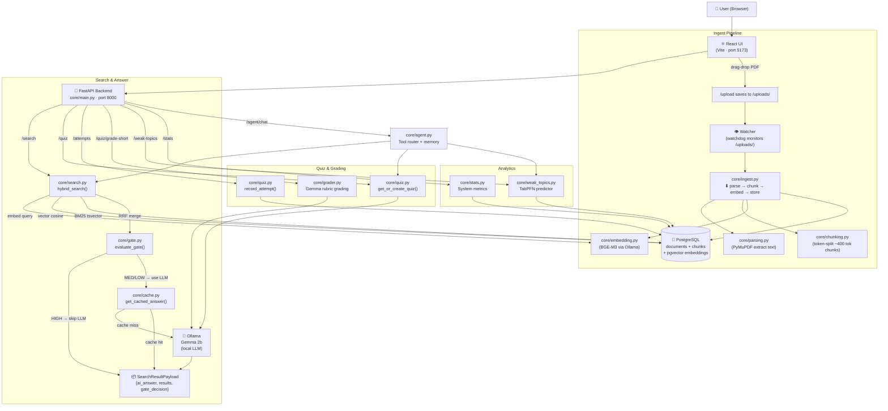

# 📖 StudyBuddy — Full System Architecture & Working

## What is StudyBuddy?

StudyBuddy is a **local-first AI study assistant**. You drop your PDF notes into it, and it:
1. **Parses & indexes** them into a PostgreSQL database (with vector embeddings)
2. **Answers your questions** using hybrid search + Gemma LLM (running locally via Ollama)
3. **Generates quizzes** from your notes and grades your answers
4. **Predicts your weak topics** based on your quiz performance

Everything runs on **your machine** — no cloud, no data leaving your computer.

---

## 🗺️ System Overview



---

## 📂 File-by-File Explanation

### Backend — `core/`

| File | Role | Key Function |
|------|------|-------------|
| [main.py](file:///c:/Users/livan/studybuddy/core/main.py) | FastAPI entrypoint — all HTTP routes | `/search`, `/upload`, `/quiz`, `/stats`, `/agent/chat` |
| [parsing.py](file:///c:/Users/livan/studybuddy/core/parsing.py) | PDF text extraction using PyMuPDF | `parse_pdf(path)` → list of `{page, text}` |
| [chunking.py](file:///c:/Users/livan/studybuddy/core/chunking.py) | Splits pages into ~400-token chunks | `chunk_document(pages)` → list of chunks |
| [embedding.py](file:///c:/Users/livan/studybuddy/core/embedding.py) | Sends text to Ollama BGE-M3 for vectors | `embed_batch(texts)` → `list[list[float]]` |
| [ingest.py](file:///c:/Users/livan/studybuddy/core/ingest.py) | Orchestrates parse → chunk → embed → DB insert | `ingest_file(path)` |
| [search.py](file:///c:/Users/livan/studybuddy/core/search.py) | Hybrid vector + BM25 search with RRF | `hybrid_search(query, k)` |
| [gate.py](file:///c:/Users/livan/studybuddy/core/gate.py) | Confidence gate (skip LLM if top score is high) | `evaluate_gate(results)` → `GateConfidence` |
| [cache.py](file:///c:/Users/livan/studybuddy/core/cache.py) | Semantic answer cache via pgvector | `get_cached_answer(q)` / `cache_answer(q, a)` |
| [answer.py](file:///c:/Users/livan/studybuddy/core/answer.py) | Calls Gemma via Ollama to synthesize answer | `synthesize_answer(query, chunks)` |
| [quiz.py](file:///c:/Users/livan/studybuddy/core/quiz.py) | Generate MCQ + short-answer questions | `get_or_create_quiz(topic, count)` |
| [grader.py](file:///c:/Users/livan/studybuddy/core/grader.py) | Grade free-text answers with Gemma rubric | `grade_short_answer(question_id, user_answer)` |
| [weak_topics.py](file:///c:/Users/livan/studybuddy/core/weak_topics.py) | Predict weak study areas from attempt history | `predict_weak_topics()` |
| [stats.py](file:///c:/Users/livan/studybuddy/core/stats.py) | Operational metrics (cache hit %, LLM usage) | `get_system_stats()` |
| [agent.py](file:///c:/Users/livan/studybuddy/core/agent.py) | Tool-routing agent with thread memory | `agent_chat(thread_id, message)` |
| [db.py](file:///c:/Users/livan/studybuddy/core/db.py) | SQLAlchemy models + Session factory | `Document`, `Chunk`, `QuestionModel`, `AttemptModel` |
| [config.py](file:///c:/Users/livan/studybuddy/core/config.py) | Settings from `.env` (Pydantic BaseSettings) | `settings.OLLAMA_BASE_URL`, `settings.DATABASE_URL` |

### Frontend — `ui/src/`

| File | Role |
|------|------|
| [App.tsx](file:///c:/Users/livan/studybuddy/ui/src/App.tsx) | Root layout — header, sidebar, tab routing |
| [SearchBox.tsx](file:///c:/Users/livan/studybuddy/ui/src/components/SearchBox.tsx) | Ask a question → shows AI Answer card + collapsible sources |
| [DropZone.tsx](file:///c:/Users/livan/studybuddy/ui/src/components/DropZone.tsx) | Drag-and-drop PDF uploader |
| [UploadStatus.tsx](file:///c:/Users/livan/studybuddy/ui/src/components/UploadStatus.tsx) | Shows list of ingested documents |
| [QuizView.tsx](file:///c:/Users/livan/studybuddy/ui/src/components/QuizView.tsx) | MCQ + short-answer quiz interface |
| [DashboardView.tsx](file:///c:/Users/livan/studybuddy/ui/src/components/DashboardView.tsx) | Weak Topics + system stats |

---

## 🔄 Full Request Flow: "What are the 17 SDGs?"

```
User types question in SearchBox
        │
        ▼
POST /search  {query: "What are the 17 SDGs?", synthesize: true}
        │
        ├─ 1. Cache Check ──────────────────────────────────────────────────────
        │   core/cache.py: embed query → search answer_cache table for similar Q
        │   → CACHE HIT → return cached answer instantly (no LLM call)
        │   → CACHE MISS → continue ↓
        │
        ├─ 2. Hybrid Search ───────────────────────────────────────────────────
        │   core/search.py: hybrid_search("What are the 17 SDGs?", k=5)
        │     a) embed_batch(["What are the 17 SDGs?"]) → 1024-dim vector (BGE-M3)
        │     b) Vector search: SELECT chunks ORDER BY embedding <=> query_vec LIMIT 20
        │     c) BM25 search:   SELECT chunks WHERE tsv @@ websearch_to_tsquery(...)
        │     d) RRF merge:     score = Σ 1/(60 + rank) for each chunk from both lists
        │     → top-5 chunks returned with fused_score, page, filename, heading
        │
        ├─ 3. Confidence Gate ────────────────────────────────────────────────
        │   core/gate.py: evaluate_gate(results)
        │     → HIGH (margin > 0.1 and top score > 0.02) → gate_decision="HIGH"
        │     → MEDIUM / LOW → gate_decision="MEDIUM_LOW"
        │   (gate currently doesn't block LLM — synthesize always runs if enabled)
        │
        ├─ 4. LLM Answer Synthesis ───────────────────────────────────────────
        │   core/answer.py: synthesize_answer(query, top_3_chunks)
        │     → builds citation prompt: "Source [filename, p.X]:\n{chunk_text}"
        │     → POST http://localhost:11434/api/generate  model=gemma:2b
        │     → returns 1-3 bulleted pointer statements citing sources
        │     → auto caches the Q→A pair for future requests
        │
        └─ 5. Response ────────────────────────────────────────────────────────
            {
              ai_answer: "• SDGs adopted in 2015 [Module_1_Key_Notes.pdf, p.2]\n• 17 goals...",
              gate_decision: "MEDIUM_LOW",
              cache_hit: false,
              results: [ {chunk_id, text, filename, page, fused_score, ...}, ... ]
            }

UI renders:
  ┌─────────────────────────────────────────┐
  │ 🤖 AI Answer                            │
  │ • SDGs adopted in 2015 [Module_1.pdf]  │
  │ • 17 goals covering poverty, climate... │
  └─────────────────────────────────────────┘
  ▼ Source Passages (collapsed, click to expand)
    📄 Module_1.pdf  p.2  score 0.032
    📄 Module_1.pdf  p.5  score 0.028
```

---

## 🧠 Where Ollama / Gemma is Used

| Task | Model | Endpoint |
|------|-------|----------|
| **Embedding** (index & query) | `bge-m3` | `POST /api/embeddings` |
| **Answer Synthesis** | `gemma:2b` | `POST /api/generate` |
| **Quiz Generation** (MCQ + short-answer) | `gemma:2b` | `POST /api/generate` |
| **Free-text Grading** (rubric scoring) | `gemma:2b` | `POST /api/generate` |

> **Check Ollama is responding:**  
> Open browser → `http://localhost:11434`  
> Or run: `curl http://localhost:11434/api/tags`

---

## 🗄️ Database Schema (PostgreSQL)

```
documents          chunks                  answer_cache
──────────         ──────────              ────────────
id                 id                      id
filename           doc_id (FK→documents)   question
sha256             text                    question_emb (vector)
status             page                    answer
ingested_at        heading                 created_at
                   embedding (vector)
                   tsv (tsvector for BM25)

questions          attempts
─────────          ────────
id                 id
topic              question_id (FK)
question_text      topic
type (mcq/short)   correct (bool)
options (JSONB)    seconds_taken
answer             attempted_at
difficulty
```

---

## 🚀 How to Run Everything

```bash
# 1. Start infrastructure (PostgreSQL + Ollama)
docker-compose up -d

# 2. Start backend API
cd c:\Users\livan\studybuddy
.venv\Scripts\activate
uvicorn core.main:app --reload --port 8000

# 3. Start frontend
cd ui
npm run dev   # → http://localhost:5173

# 4. Check backend health
curl http://localhost:8000/health
# → {"status": "ok"}

# 5. Check Ollama
curl http://localhost:11434/api/tags
```

---

## 🔍 Key Design Decisions

| Decision | Why |
|----------|-----|
| **Hybrid Search (Vector + BM25)** | Vector alone misses exact keyword matches; BM25 alone misses semantic similarity. RRF fusion gives best of both. |
| **Answer Cache** | Repeated questions (e.g., exam prep) hit cache instantly — no Ollama call needed. Cache uses semantic similarity so "What are SDGs?" and "List the SDGs" return same cached answer. |
| **Confidence Gate** | High-confidence retrievals could skip LLM entirely; saves latency when top chunk is an exact match. |
| **Local-first (Ollama)** | No API keys, no data leaving your machine, works offline. |
| **`num_predict: 80`** | Gemma is capped at 80 tokens output — forces concise bullet answers instead of long essays. |
| **Token-based Chunking** | PDFs without sentence punctuation (like lecture slides/tables) are chunked by token count (~400) not by sentence, avoiding whole-page chunks. |
